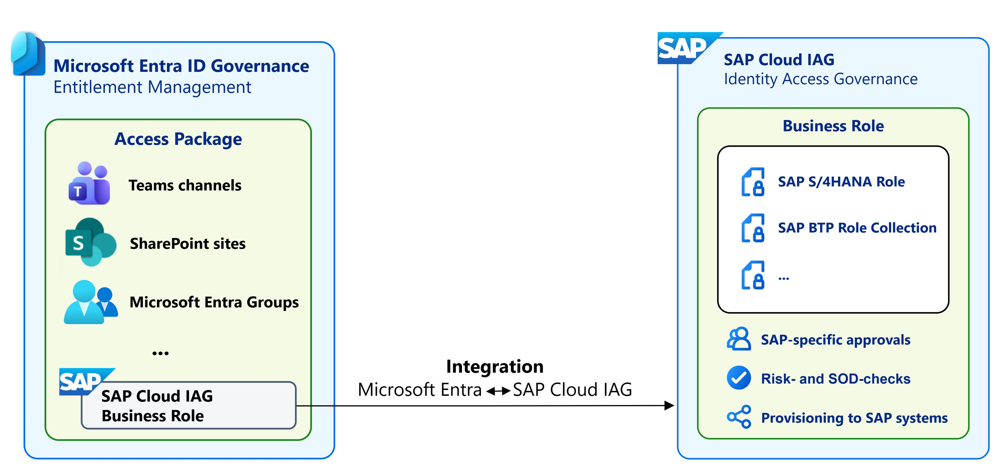
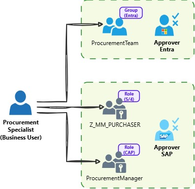
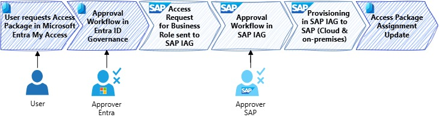
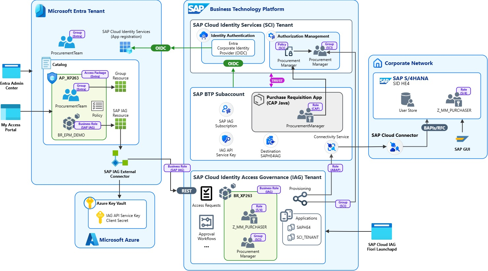

# XP263 | Identity lifecycle and governance with SAP services and Microsoft Entra

## Description

This repository contains the material for the SAP TechEd 2026 session [XP263 - Identity lifecycle and governance with SAP services and Microsoft Entra](https://www.sap.com/events/teched/berlin/flow/sap/te26/catalog/page/catalog/session/1786630013489001Nv9u).  

## Overview

In this hands-on session, you will learn how to combine **Microsoft Entra ID Governance** with **SAP Cloud Identity Access Governance (SAP Cloud IAG)** to create an end-to-end access governance process for SAP applications.

The scenario demonstrates how Microsoft Entra access packages can be used as the central entry point for requesting business access while SAP Cloud IAG provides SAP-specific access governance and provisioning. A business role defined in SAP Cloud IAG is exposed as a resource in Microsoft Entra, where it becomes part of an access package (see *figure 1*) that business users can request through the My Access portal.
  

*Figure 1: SAP Cloud IAG and Entra integration*  

The end-to-end scenario combines:

- **Microsoft Entra ID Governance** for catalogs, access packages, access requests, and approval policies
- **SAP Cloud Identity Access Governance** for SAP business roles, approval workflows, and provisioning
- **SAP Cloud Identity Services** for authentication and authorization of SAP BTP applications
- **SAP BTP** and a Purchase Requisition application as a cloud application protected by role-based authorization
- **SAP S/4HANA** as the back-end system in which SAP authorization roles are provisioned
- **SAP Cloud Connector** and SAP BTP Connectivity service for secure communication with the on-premises SAP S/4HANA system
  

*Figure 2: Business scenario*  

The business scenario is centered around a user in the role of a procurement specialist requiring access to the following resources in SAP and Microsoft Entra (see *figure 2*):

- Membership in the **`ProcurementTeam`** security group in Microsoft Entra
- Assignment to the **`ProcurementManager`** role of a [CAP](https://cap.cloud.sap/docs/)-based BTP application to manage purchase requisitions.
- Assignment to the **`Z_MM_PURCHASER`** role in the company's S/4HANA backend system to manage purchase orders.

The required SAP applications and authorizations are represented by the SAP Cloud IAG business role `BR_XP263`. The business role bundles the access across SAP BTP the SAP S/4HANA for roles `ProcurementManager` and `Z_MM_PURCHASER`.
  

*Figure 3: Access Governance Process in the scenario*  

The user requests an Access Package in Microsoft Entra My Access, which starts an approval workflow in Microsoft Entra ID Governance (see *figure 3*). Once approved, the associated business role request is sent to SAP Cloud IAG, where it undergoes a second SAP-specific approval before SAP Cloud IAG provisions the required access to SAP cloud or on-premises systems. After successful provisioning, the resulting assignment is reflected back in the Microsoft Entra Access Package, completing the end-to-end governed access flow.

  

*Figure 4: Solution Architecture*  

You will follow the complete access lifecycle in the exercises from the perspective of administrators, a business user, and approvers, accessing the systems and applications shown in *figure 4*:

1. Create the business role in SAP Cloud IAG.
2. Create a Microsoft Entra access package containing the Microsoft Entra group membership and SAP Cloud IAG business role.
3. Request the access package as a business user.
4. Approve the request in Microsoft Entra.
5. Approve the resulting access request in SAP Cloud IAG.
6. Provision the required access and verify that the business user can access the applications.

By completing these exercises, you will see how Microsoft Entra and SAP identity governance capabilities can work together to provide a governed access process across Microsoft, SAP cloud, and SAP on-premises environments.

## Requirements

The requirements to follow the exercises in this repository are described in the [Getting Started section](./exercises/ex0/README.md). Start here to setup the mandatory Multifactor Authentication (MFA) for your Microsoft Entra admin user in this session.

## Exercises

- [Getting Started](exercises/ex0/)
- [Exercise 1 - Create business role in SAP Cloud IAG](exercises/ex1/)
- [Exercise 2 - Create the access package in Microsoft Entra](exercises/ex2/)
- [Exercise 3 - Request the access package in Entra](exercises/ex3/)
- [Exercise 4 - Approve the access package in Entra](exercises/ex4/)
- [Exercise 5 - Approve the access request in SAP Cloud IAG](exercises/ex5/)
- [Exercise 6 - Provision and verify user access](exercises/ex6/)

## Additional Resources

- Microsoft Learn: [Microsoft Entra SAP IAG integration](https://learn.microsoft.com/en-us/entra/id-governance/entitlement-management-sap-integration)
- Microsoft Learn: [Migrate identity management scenarios from SAP IDM to Microsoft Entra](https://learn.microsoft.com/en-us/entra/id-governance/scenarios/migrate-from-sap-idm)
- SAP Community Network Blog: [Identity and Access Management with Microsoft Entra, Part IV: Integration with SAP Cloud IAG](https://community.sap.com/t5/technology-blog-posts-by-members/identity-and-access-management-with-microsoft-entra-part-iv-integration/ba-p/14481389)
- SAP on Azure Video Podcast, Episode 307: [Integration with Cloud IAG](https://www.saponazurepodcast.de/episode307/)
- SAP BTP CAP Purchase Requisition application used in this scenario: [GitHub Repository](https://github.com/raepple/CAPProcurementApp)

## Contributing
Please read the [CONTRIBUTING.md](./CONTRIBUTING.md) to understand the contribution guidelines.

## Code of Conduct
Please read the [SAP Open Source Code of Conduct](https://github.com/SAP-samples/.github/blob/main/CODE_OF_CONDUCT.md).

## How to obtain support

Support for the content in this repository is available during the actual time of the online session for which this content has been designed. Otherwise, you may request support via the [Issues](../../issues) tab.

## License
Copyright 2026 SAP SE or an SAP affiliate company and <your-project> contributors. Please see our [LICENSE](LICENSE) for copyright and license information. Detailed information including third-party components and their licensing/copyright information is available [via the REUSE tool](https://api.reuse.software/info/github.com/SAP/<your-project>).
