# Exercise 1 - Create business role in SAP Cloud IAG

The business role `BR_XP263_<NN>` in SAP Cloud IAG represents the business-level bundle of access and groups the technical roles and permissions spanning SAP BTP and SAP S/4HANA on-premise in this scenario. It governs all SAP access for the user rather than assigning individual technical roles directly, while applying SAP-specific approval controls.

| Step   | Description                | Screenshot |
| :----- | :------------------------- | :--------- |
| 01     | Open a **new tab** in the Chrome browser. |<a href="./images/1-1.jpg" target="_blank">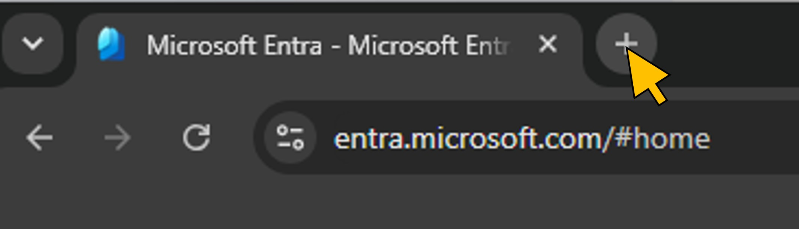</a>|
| 02     | Go to the SAP Cloud IAG tenant URL [https://xp263-6cntx8l6.sapciag-ee.cfapps.us20.hana.ondemand.com](https://xp263-6cntx8l6.sapciag-ee.cfapps.us20.hana.ondemand.com).  To login, **click** the first identity provider (**axzamhxt8.accounts.ondemand.com**) from the list. |<a href="./images/1-2.jpg" target="_blank">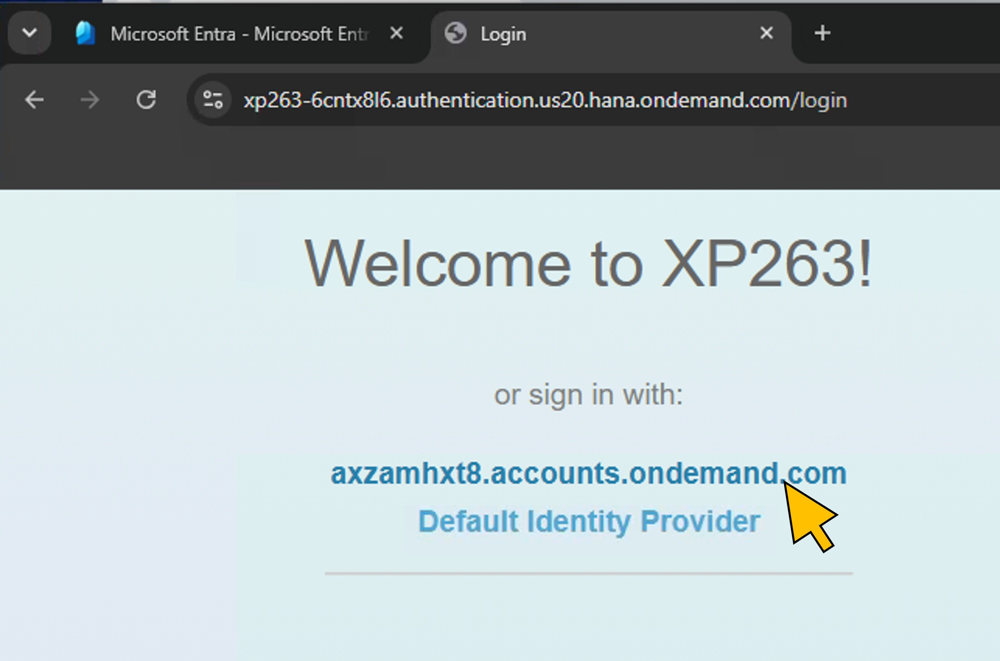</a>|
| 03     | Your are single-signed on to the SAP Cloud IAG tenant's Fiori launchpad with your **`admin-<NN>`** user.  Switch to the **Role Designer** tab. Launch the **Business Roles** app.|<a href="./images/1-3.jpg" target="_blank">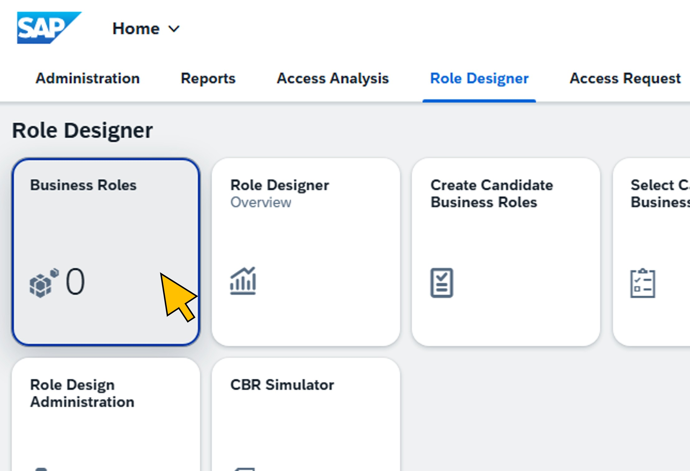</a>|
| 04     | Click **Create**. |<a href="./images/1-4.jpg" target="_blank">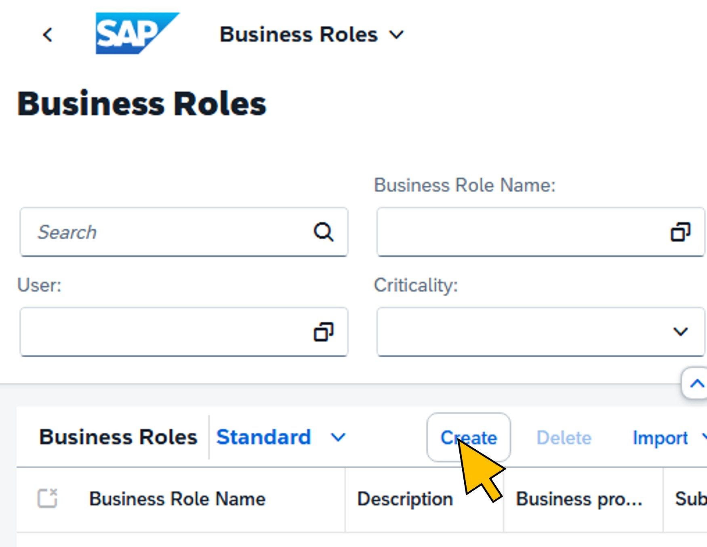</a>|
| 05     | For the business role name, enter **`BR_XP263_<NN>`**. Replace **`<NN>`** with the number of your seat.  Provide a **Description**, for example "Business role for SAP access governance**.  In the **Business process** drop-down list, select **GLOBAL Business Process**.  On the **Access** tab, click **Add**.|<a href="./images/1-5.jpg" target="_blank">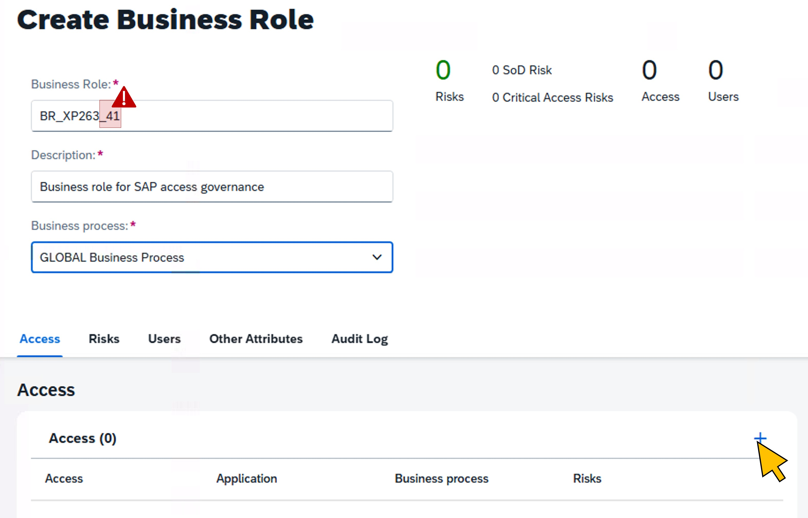</a>|
| 06     | Enter **`SAP_BC_EPM_DEMO`** in the **Search Access** search bar and click the **magnifying glass** symbol.  From the search results, click **Add** on the **EPM Demo Role** entry for the *S4HANA_HE4* application.|<a href="./images/1-6.jpg" target="_blank">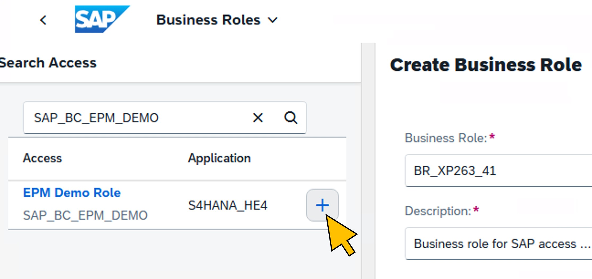</a>|
| 07     | Repeat the previous step by entering **`TaskManager`** in the search bar and click the **magnifying glass** symbol.  From the search results, click **Add** on the **cap - TaskManager** entry for the *SCI_TENANT_AXZAMHXT8* application.|<a href="./images/1-7.jpg" target="_blank">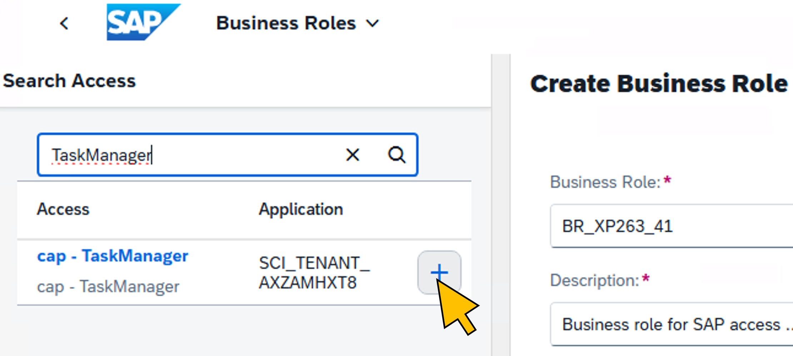</a>|
| 08     | You've now added the technical permissions from the S/4HANA on-premises system and the SAP BTP CAP application to your new business role.  Click **Close**. |<a href="./images/1-8.jpg" target="_blank">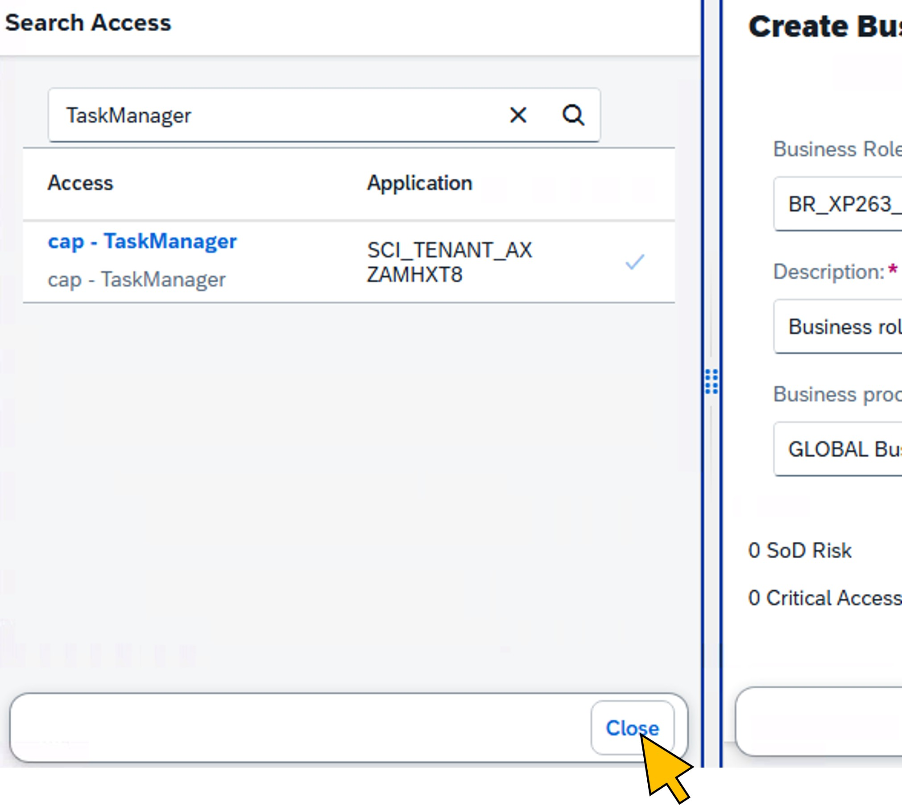</a>|
| 09     | Switch to the **Other attributes** tab.  Click on the **value help** of the **Content Approvers** field.|<a href="./images/1-9.jpg" target="_blank">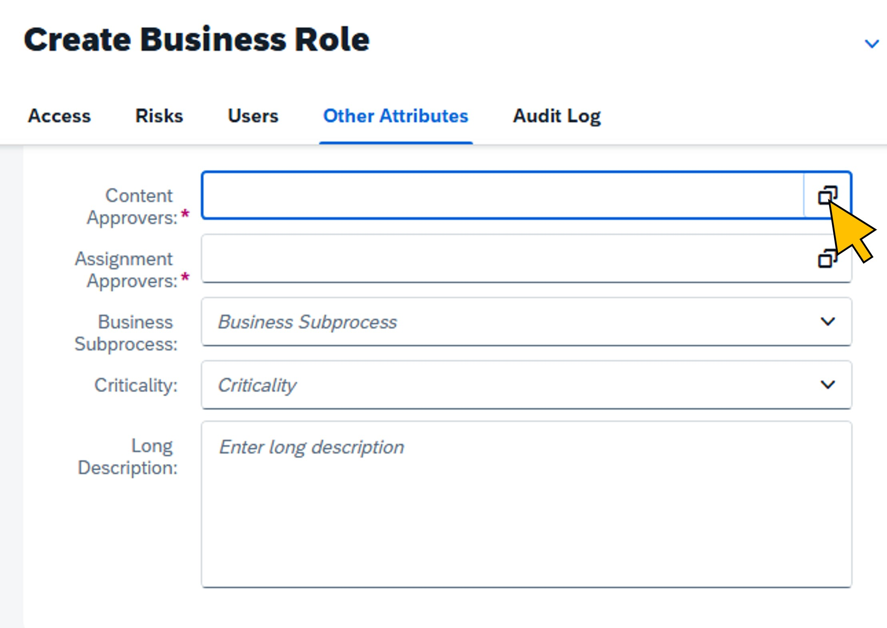</a>|
| 10     | Select the **Approver Content (P000088)** user from the list.  Click **Select**. |<a href="./images/1-10.jpg" target="_blank">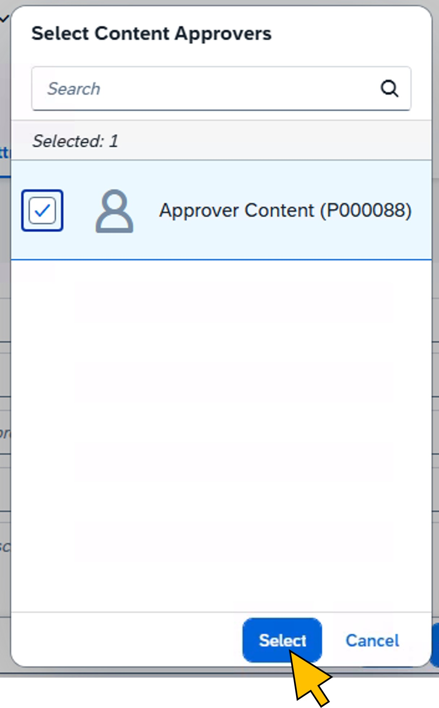</a>|
| 11     | Click on the **value help** of the **Assignment Approvers** field.|<a href="./images/1-11.jpg" target="_blank">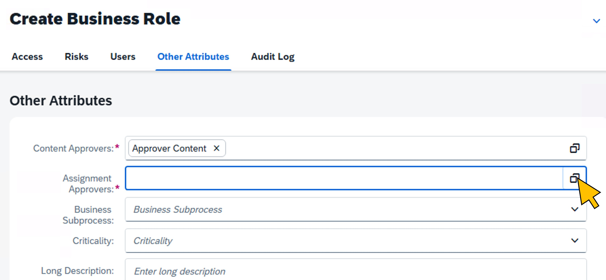</a>|
| 12     | Enter **`Approver<NN>`** in the search bar and click the **magnifying glass** symbol. Replace **`<NN>`** with the number of your seat.  Select the user **`Approver<NN> IAG`** from the list and click **Select**.|<a href="./images/1-12.jpg" target="_blank">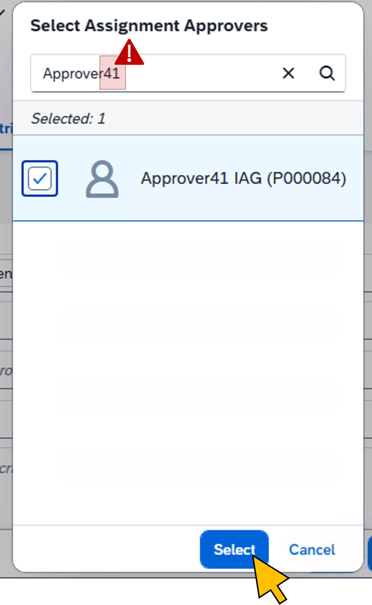</a>|
| 13     | From the **Business subprocess** drop-down list, select **`GLOBAL Sub Process`**. br>From the **Criticality** drop-down list, select **Low**.  Click **Save and Activate**.|<a href="./images/1-13.jpg" target="_blank">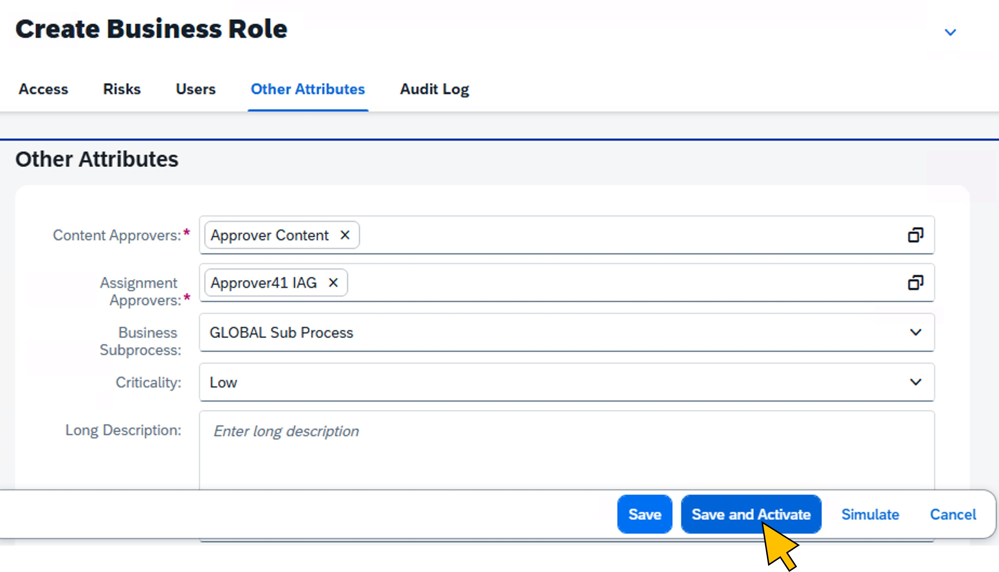</a>|

## Summary

You've now created the business role in SAP Cloud IAG. Continue to - [Exercise 2 - Create the Access Package in Microsoft Entra](../ex2/README.md)

