# Exercise 3 - Request the access package in Microsoft Entra

In this exercise, you will switch from the administrator perspective to the **business user** perspective and request access as a Procurement Specialist in the organization (see *figure 1*).

  
<a href="./images/ex3.jpg" target="_blank">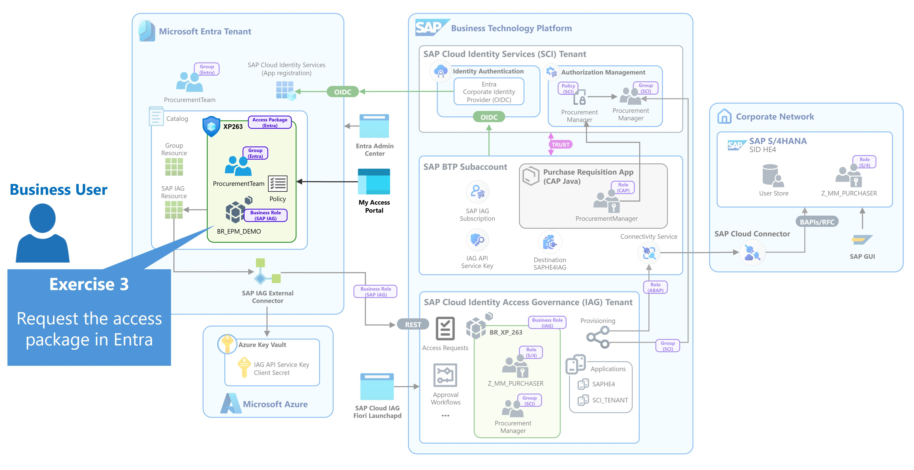</a>

*Figure 1: Exercise 3*  

Microsoft Entra My Access provides users with a self-service experience for discovering and requesting access packages for which they are eligible. Instead of requesting individual SAP roles or application permissions, the business user requests access based on a recognizable business function.

You will sign in to My Access and request the `AP_XP263` access package containing the access required for the Procurement Specialist function.

Submitting the request starts the governance process. The request must first satisfy the Microsoft Entra approval policy before the SAP-specific governance process can continue in SAP Cloud IAG.

At the end of this exercise, the access package request has been submitted and is waiting for approval.

| Step   | Description                | Screenshot |
| :----- | :------------------------- | :--------- |
| 01     | abc |<a href="./images/3-1.jpg" target="_blank">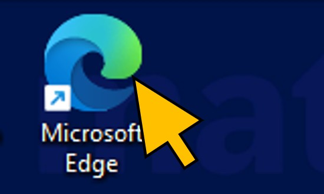</a>|
| 02     | abc |<a href="./images/3-2.jpg" target="_blank">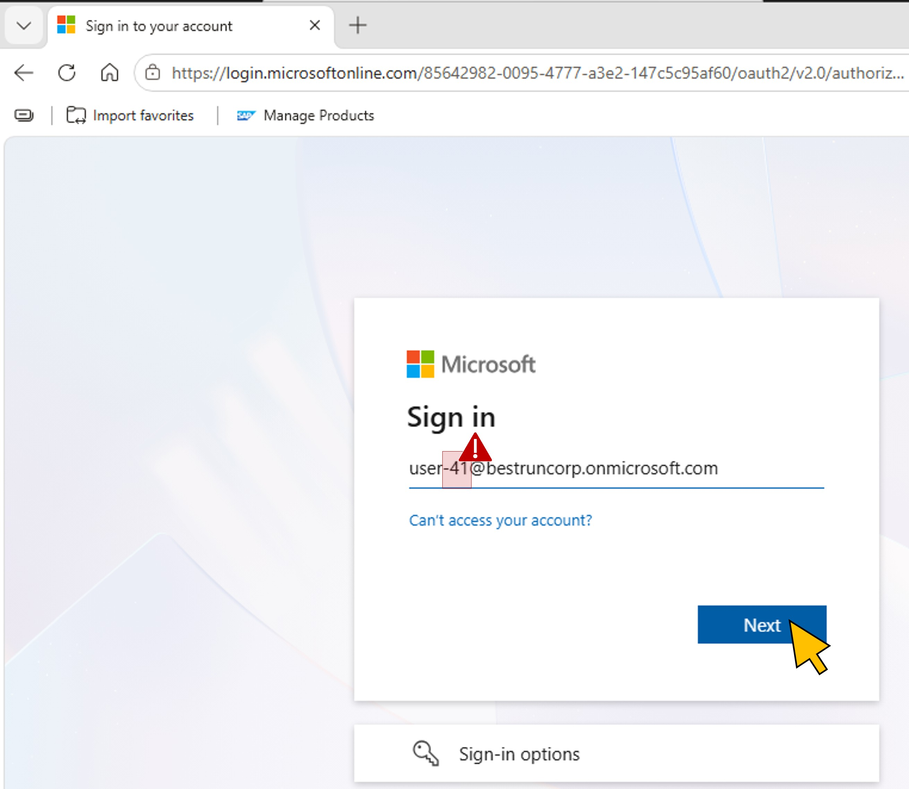</a>|
| 03     | abc |<a href="./images/3-3.jpg" target="_blank">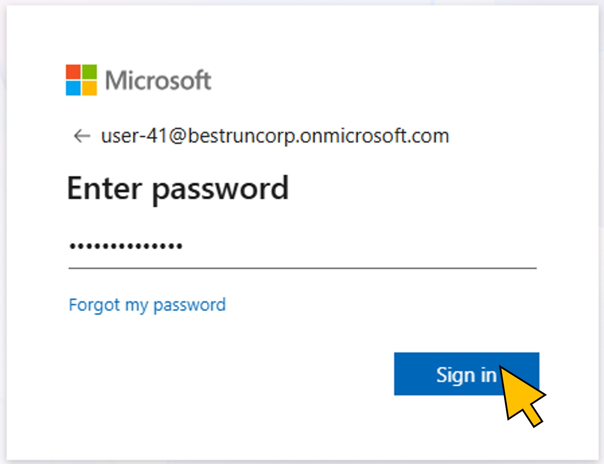</a>|
| 04     | abc |<a href="./images/3-4.jpg" target="_blank">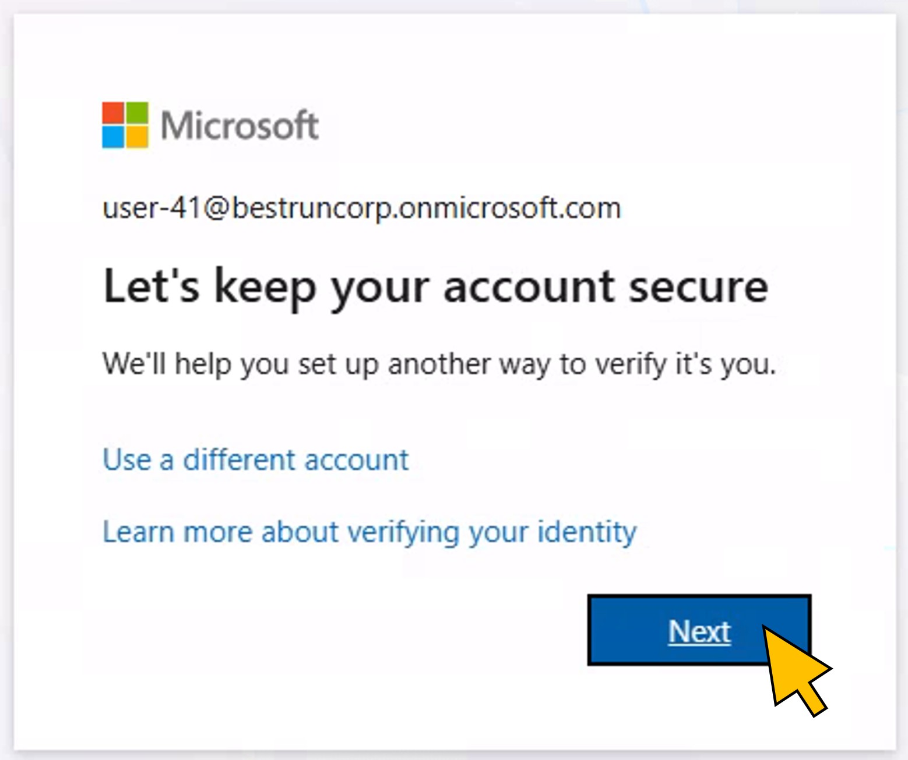</a>|
| 05     | abc |<a href="./images/3-5.jpg" target="_blank">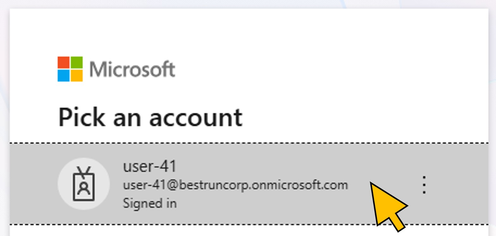</a>|
| 06     | abc |<a href="./images/3-6.jpg" target="_blank">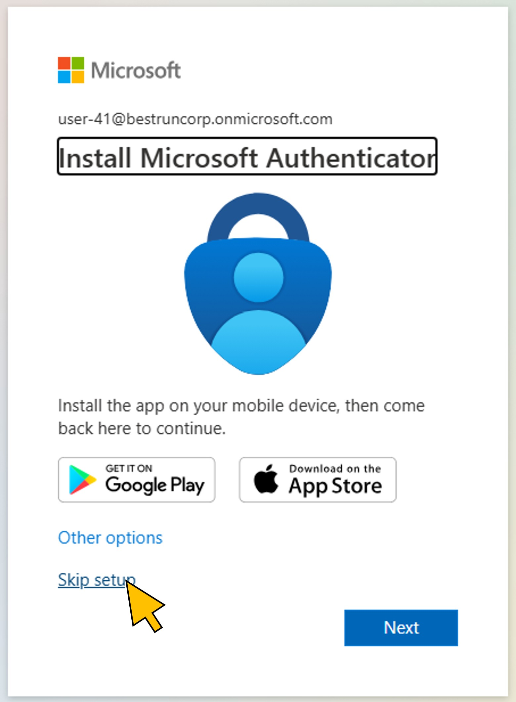</a>|
| 07     | abc |<a href="./images/3-7.jpg" target="_blank">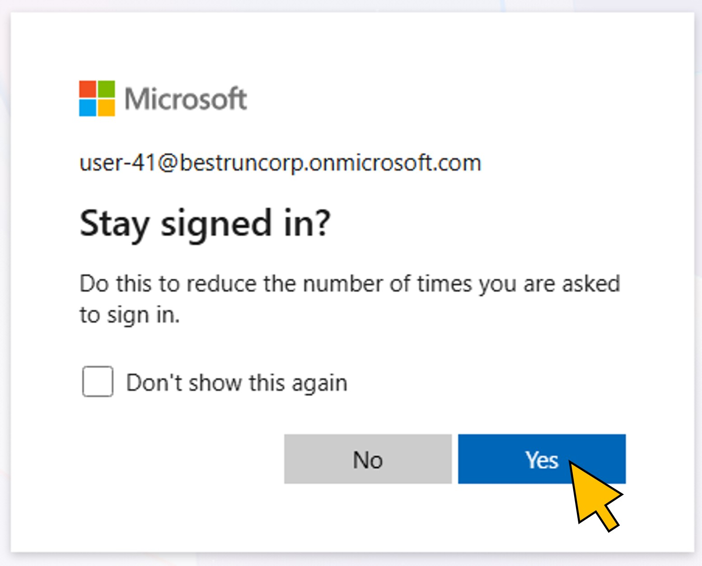</a>|
| 08     | abc |<a href="./images/3-8.jpg" target="_blank">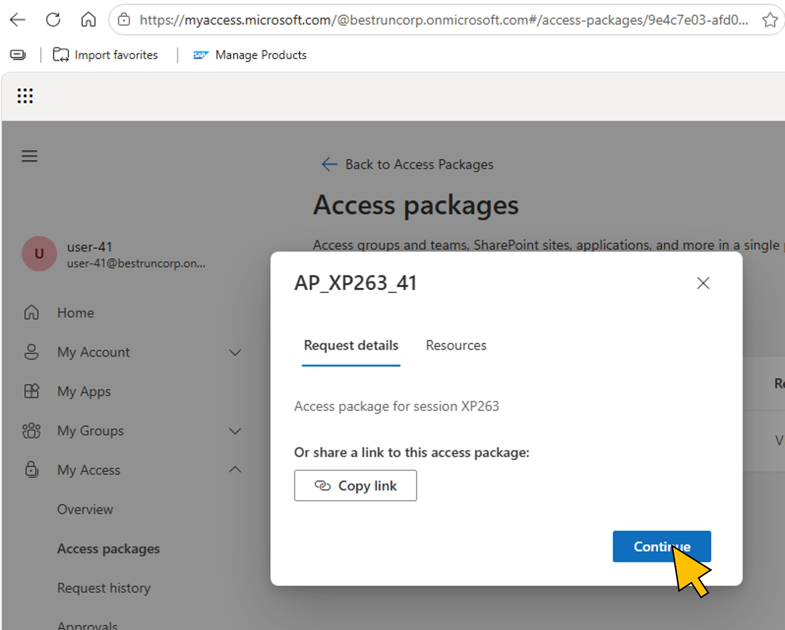</a>|
| 09     | abc |<a href="./images/3-9.jpg" target="_blank">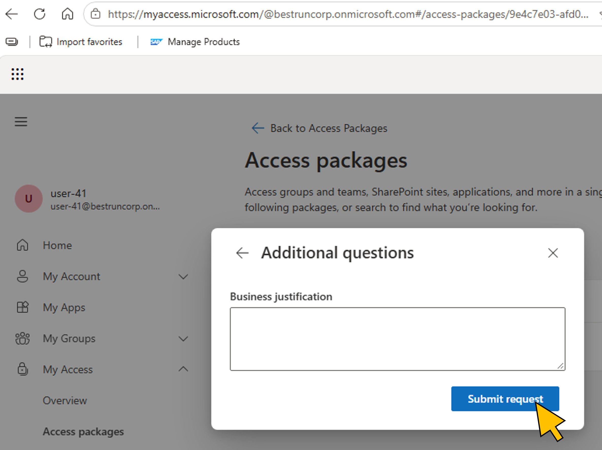</a>|
| 10     | abc |<a href="./images/3-10.jpg" target="_blank">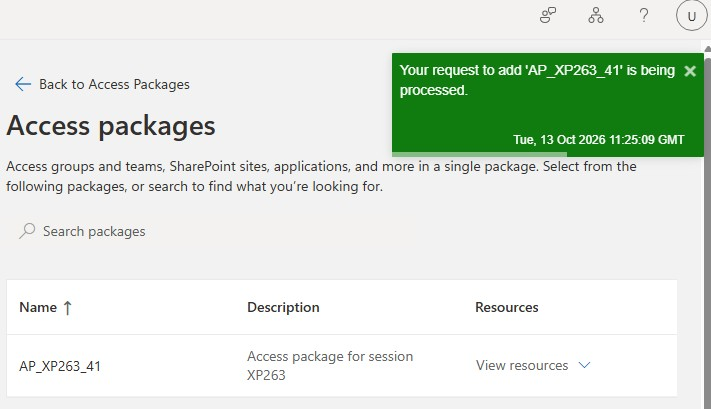</a>|
| 11     | abc |<a href="./images/3-11.jpg" target="_blank">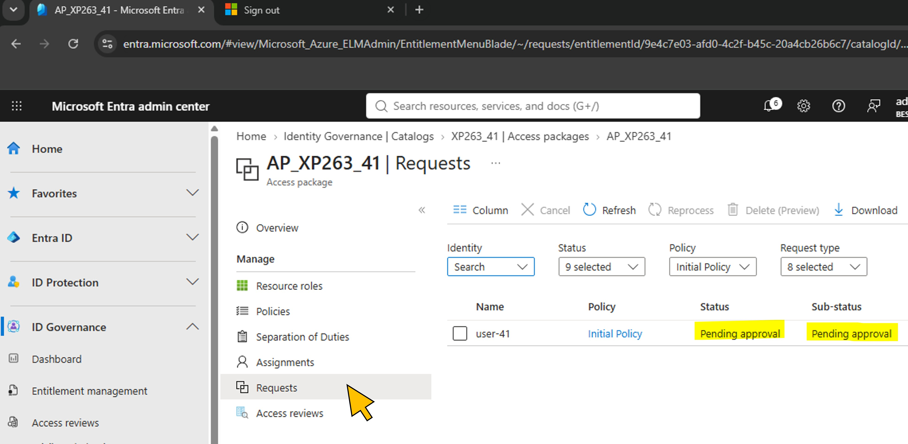</a>|

Continue to - [Exercise 4 - Approve the access package in Microsoft Entra](../ex4/README.md)
