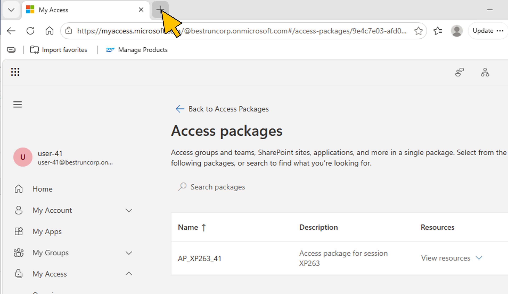
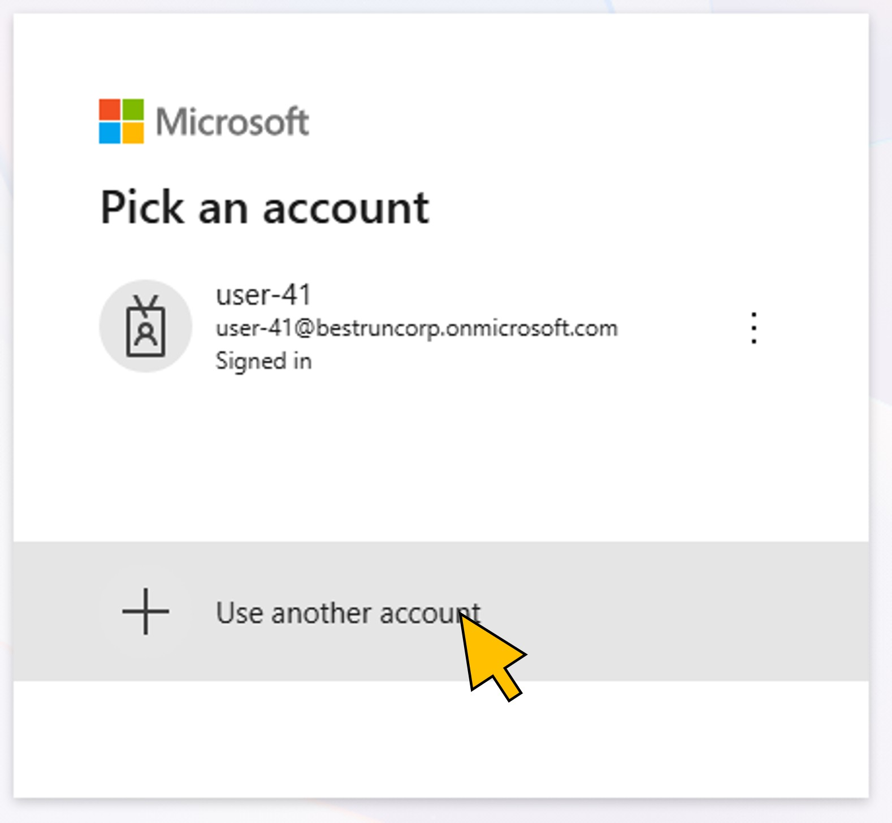
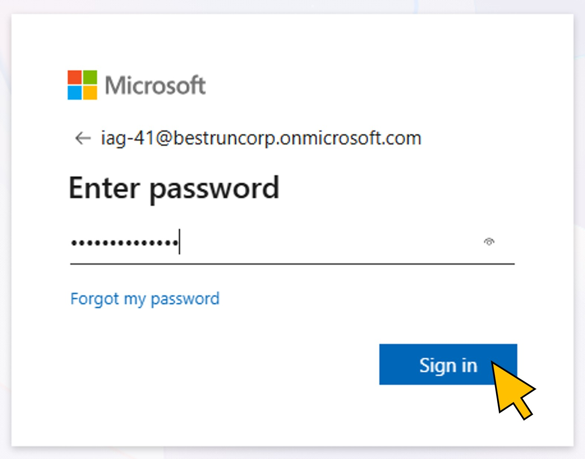
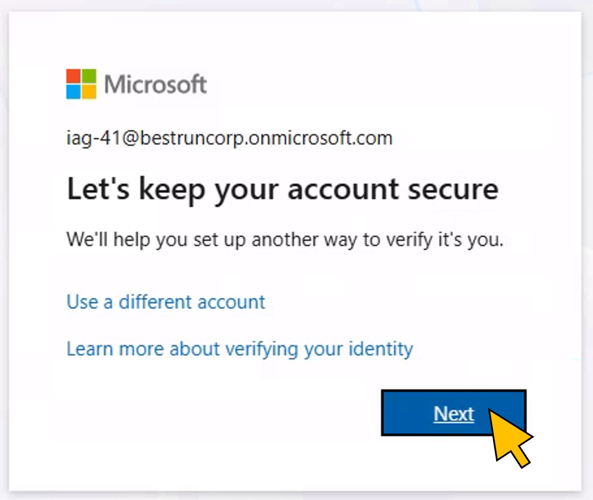
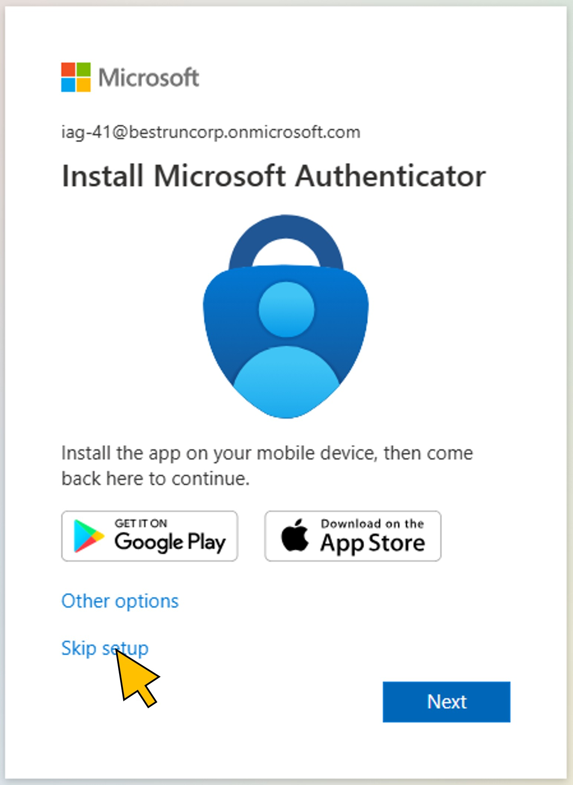
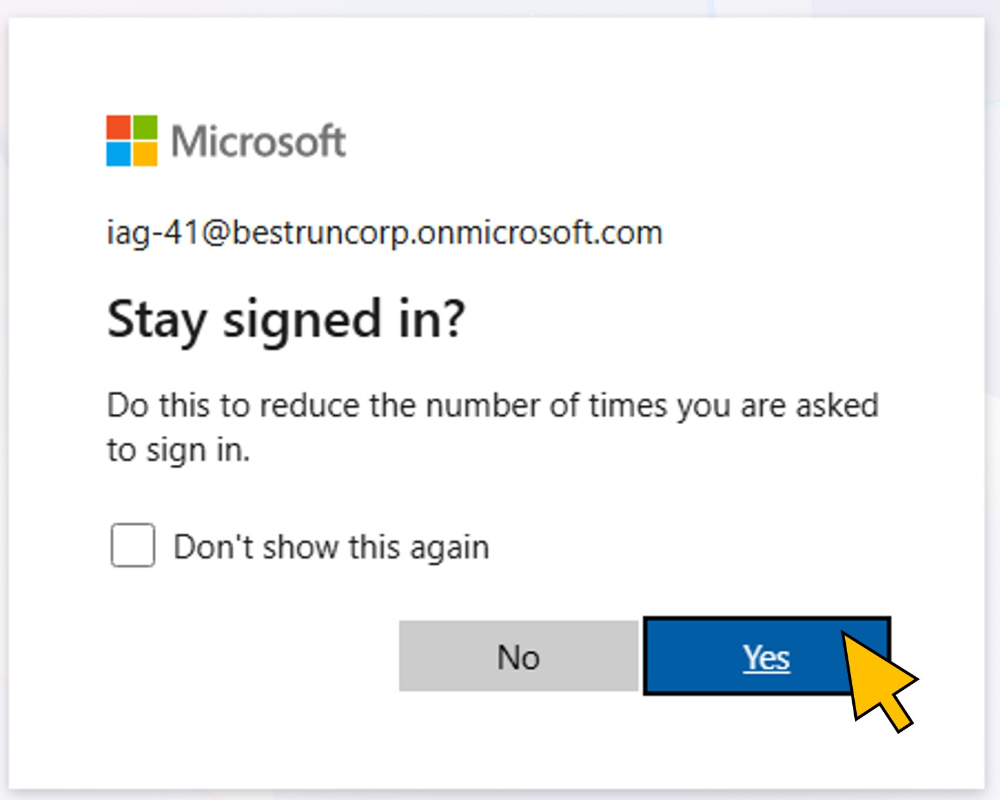
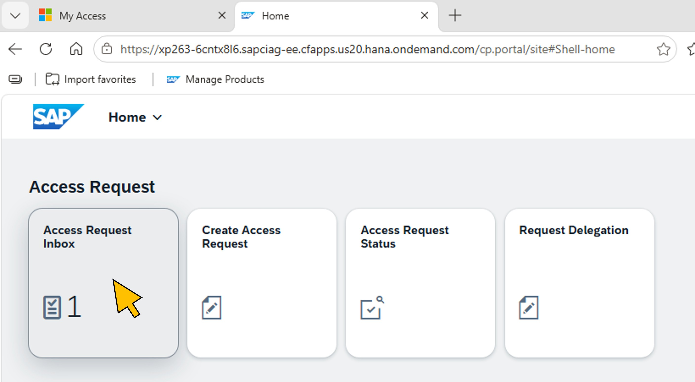

# Exercise 4 - Approve SAP access in SAP Cloud IAG

In this exercise, we will create...

| Step   | Description                | Screenshot |
| :----- | :------------------------- | :--------- |
| 01     | abc ||
| 02     | abc ||
| 03     | abc ||
| 04     | abc ||
| 05     | abc ||
| 06     | abc ||
| 07     | abc ||
| 08     | abc ||
| 09     | abc ||
| 10     | abc ||
| 11     | abc ||
| 12     | abc ||

## Summary

You've now ...

Continue to - [Exercise 5 - Excercise 5 ](../ex5/README.md)
