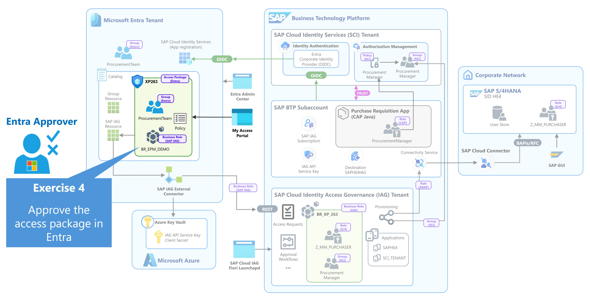

# Exercise 4 - Approve the access package in Microsoft Entra

In this exercise, you will act as the **Microsoft Entra approver** and review the access package request submitted by the business user.

  

*Figure 1: Exercise 4*  

Approval policies are an important part of Microsoft Entra entitlement management. They provide a governance checkpoint before access is assigned and allow an organization to verify that a user's request is appropriate before downstream access is initiated.

You will review the pending request in Microsoft Entra My Access and approve the user's request for the `AP_XP263` access package. After approval, Microsoft Entra passes the requested SAP business role into the SAP Cloud IAG access governance process.

At the end of this exercise, the Microsoft Entra approval stage is complete and the request can proceed to SAP Cloud IAG for SAP-specific approval.

| Step   | Description                | Screenshot |
| :----- | :------------------------- | :--------- |

Continue to - [Exercise 5 - Approve the access request in SAP Cloud IAG](../ex5/README.md)
