# Exercise 5 - Approve the access request in SAP Cloud IAG

In this exercise, you will act as the **SAP Cloud IAG approver** and perform the second governance step in the end-to-end access request process (see *figure 1*).

  
<a href="./images/ex5.jpg" target="_blank">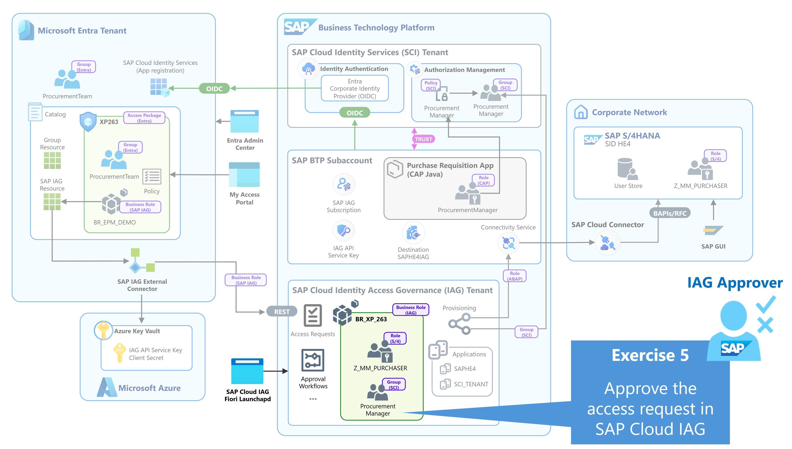</a>

*Figure 1: Exercise 5*  

While Microsoft Entra governs the user's entitlement to the access package, SAP Cloud IAG applies SAP-specific governance to the requested business role. This allows the SAP access to remain subject to the governance processes defined for the SAP environment.

The approved Microsoft Entra request results in an access request for the `BR_XP263_<NN>` business role in SAP Cloud IAG. You will open the request, review the requested access, and approve it using the SAP Cloud IAG approval workflow.

This represents the second approval level in the scenario: first the entitlement is approved in Microsoft Entra, then the SAP business role is approved in SAP Cloud IAG.

At the end of this exercise, all required approvals are complete and SAP Cloud IAG can provision the access contained in the business role to the respective target systems.

| 01     | abc |<a href="./images/5-1.jpg" target="_blank">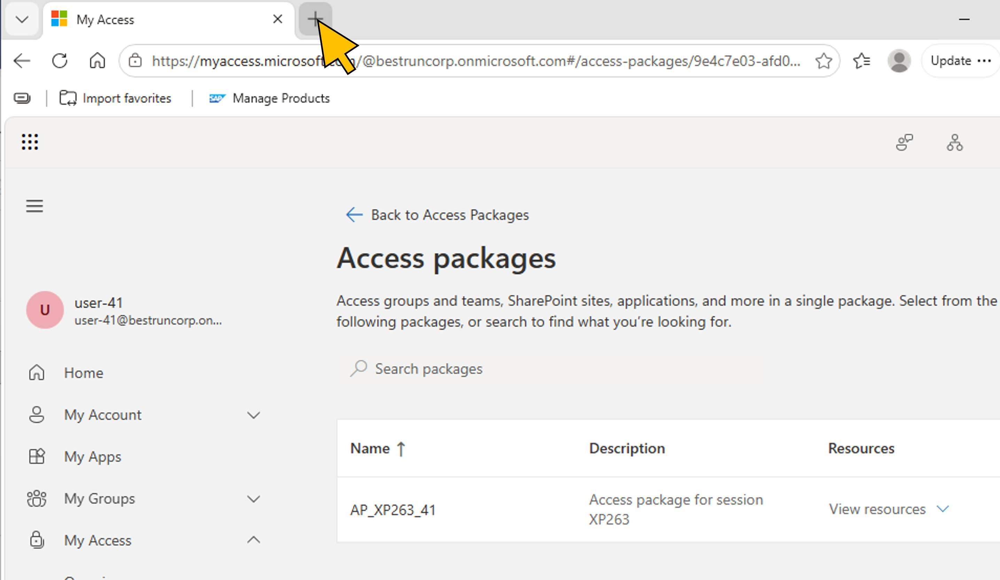</a>|
| 02     | abc |<a href="./images/5-2.jpg" target="_blank">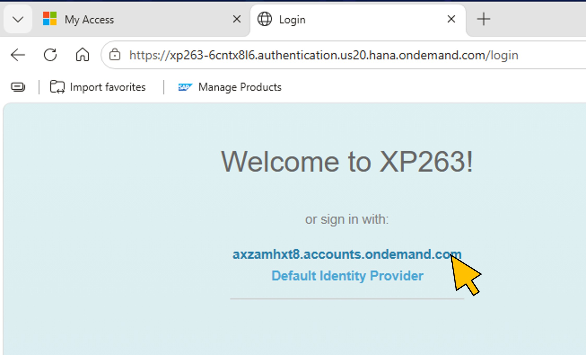</a>|
| 03     | abc |<a href="./images/5-3.jpg" target="_blank">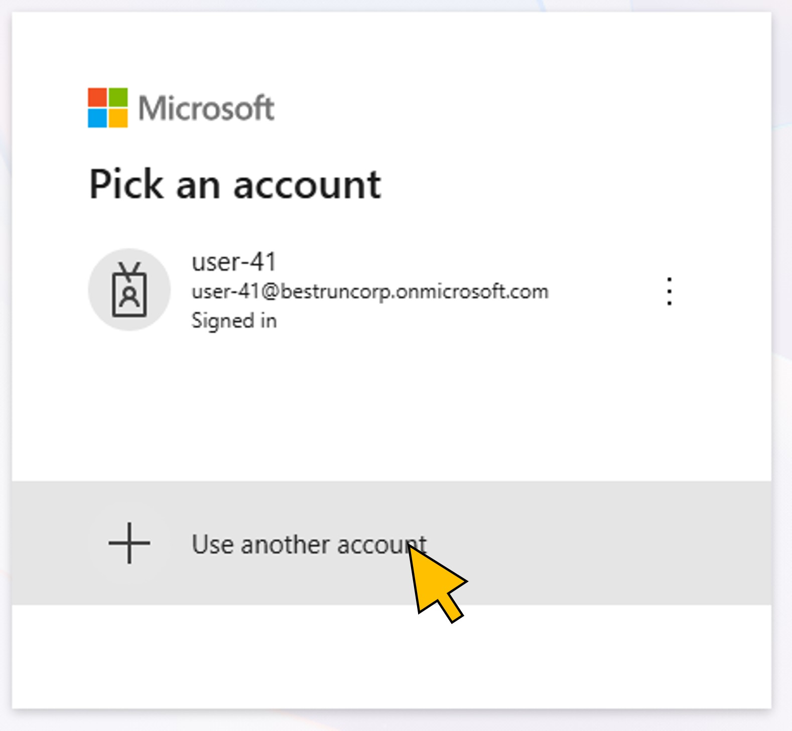</a>|
| 04     | abc |<a href="./images/5-4.jpg" target="_blank">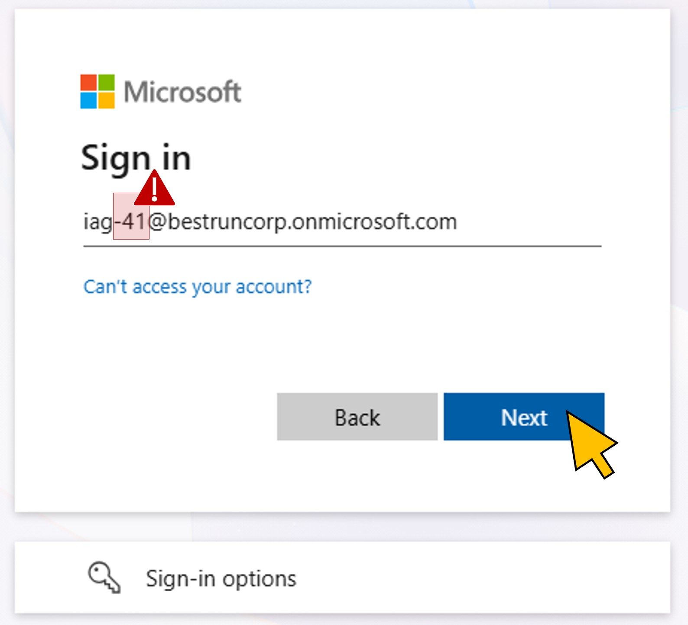</a>|
| 05     | abc |<a href="./images/5-5.jpg" target="_blank">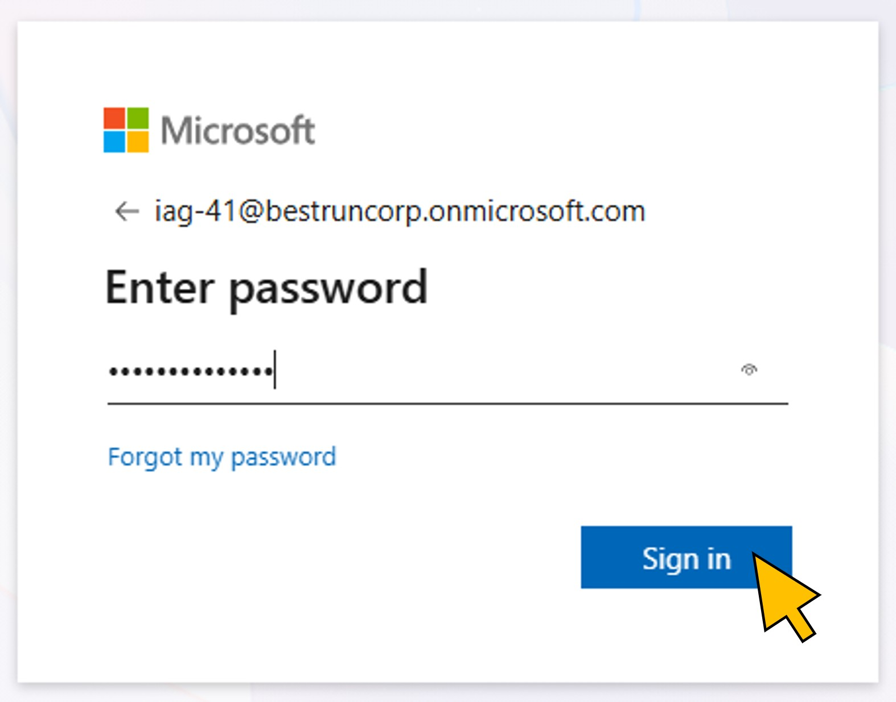</a>|
| 06     | abc ||
| 07     | abc |<a href="./images/5-7.jpg" target="_blank">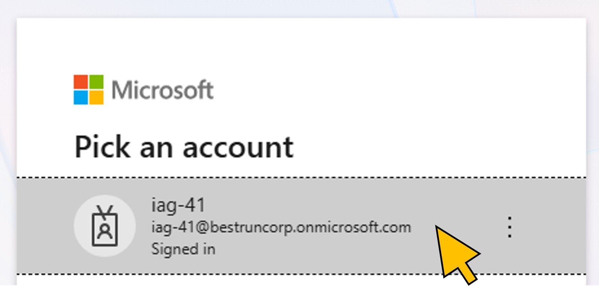</a>|
| 08     | abc ||
| 09     | abc |<a href="./images/5-9.jpg" target="_blank">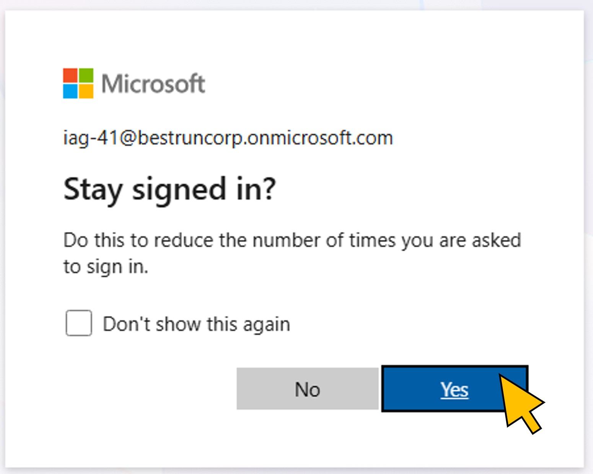</a>|
| 10     | abc |<a href="./images/5-10.jpg" target="_blank">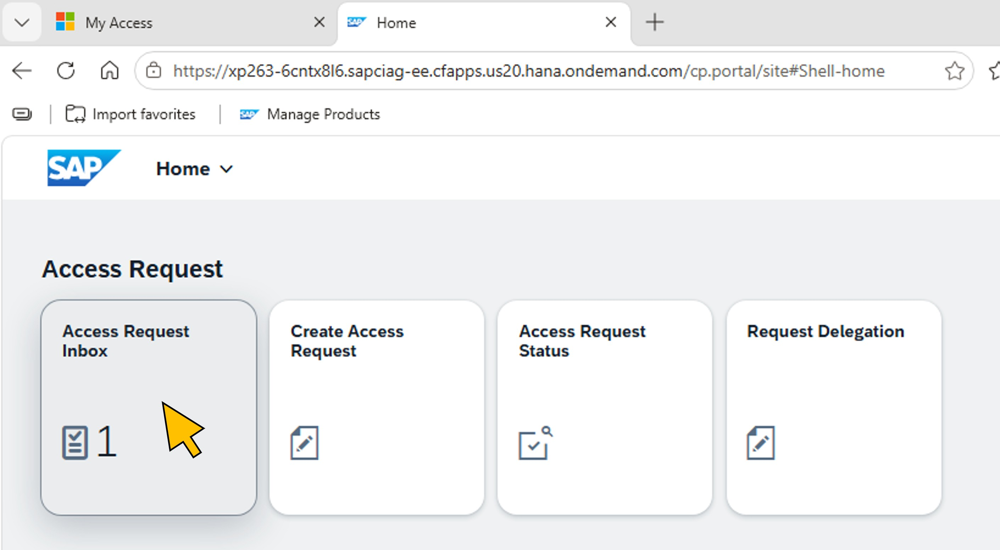</a>|
| 11     | abc |<a href="./images/5-11.jpg" target="_blank">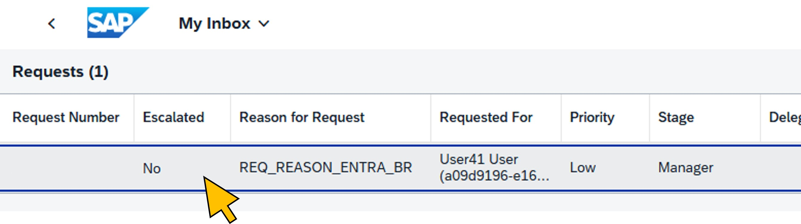</a>|
| 12     | abc |<a href="./images/5-12.jpg" target="_blank">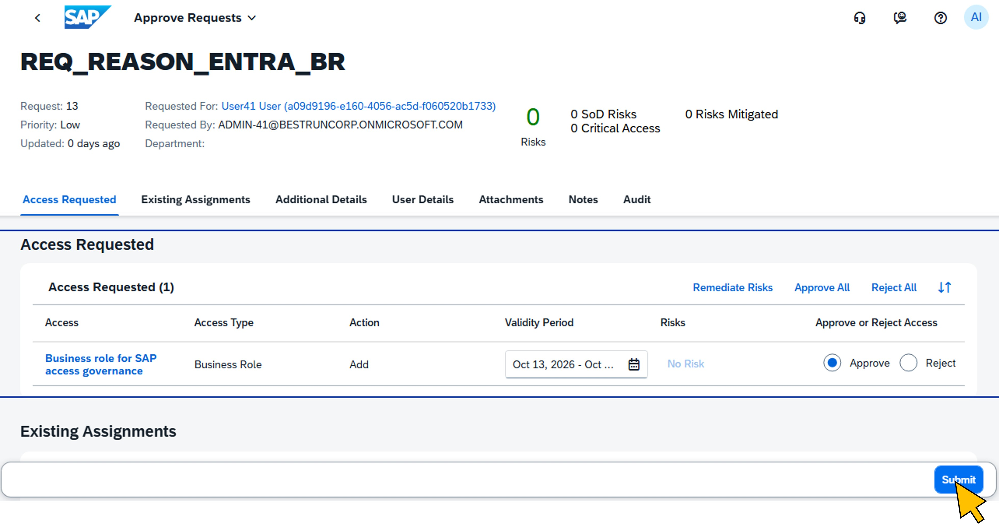</a>|

Continue to - [Exercise 6 - Provision and verify user access](../ex6/README.md)
